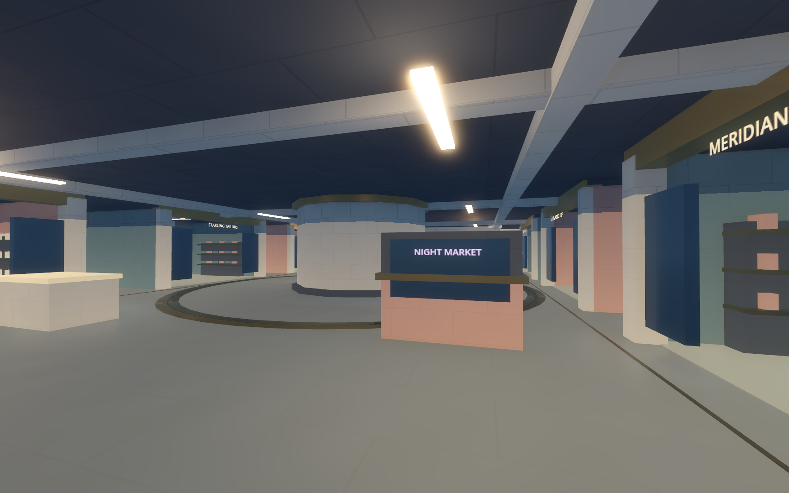
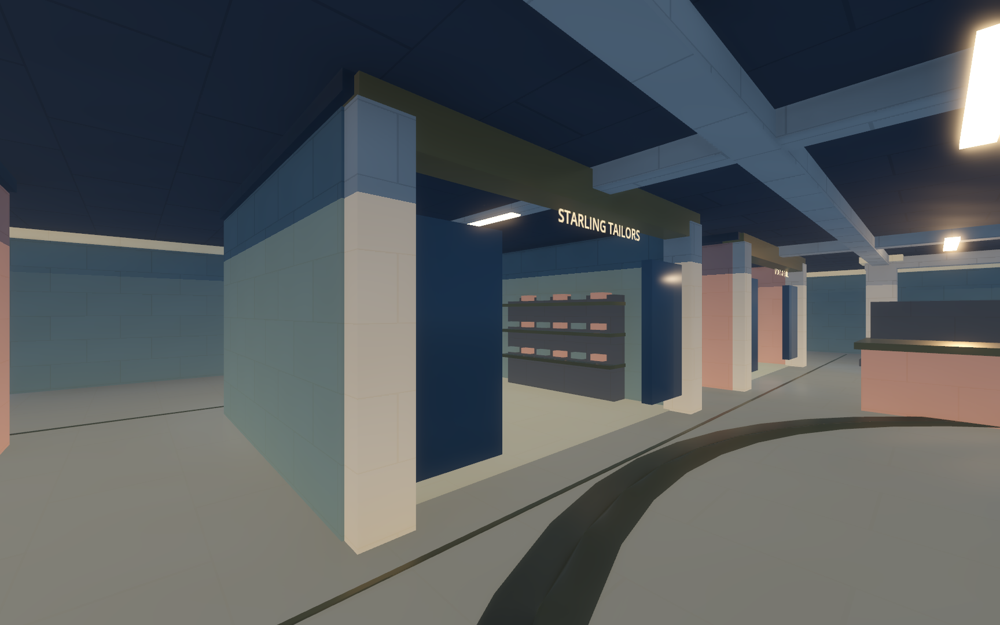
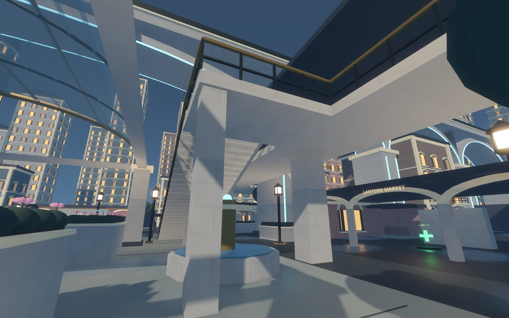
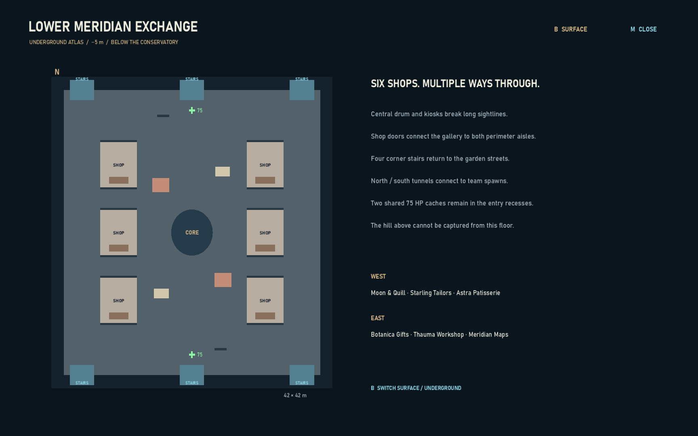

# Meridian Gardens: geometry and Exchange revision

The original revision audited the physical city and rebuilt the space beneath the control point as **Lower Meridian Exchange**, a covered shopping concourse at Y = −5 m.

## Whole-district follow-up - 17 October 2026

The wider pass covers all 18 authored flights, their approach lanes and landing exits, all four promenade corners, garden terraces, both study entries, approach arcades, shops, balconies and spawn thresholds.

- Sloped railings now use vertical swept collision matching their posts; rotated boxes previously leaned across landing ends. Intermediate stair posts meet the actual treads, and low rails have distinct crossbars below the handrail.
- Promenade decks extend to their corner bridges. Closing edge rails join the stair guards without crossing the stair mouths; all four inside corners have continuous floor support.
- The four approach apartment blocks are set back 1.5 m to clear the outer stair edges. Both study flights move to X = 47 m with a 4 m width; the north flight starts at Z = 14 m to clear the cafe wall. The existing study deck remains at Y = 4.2 m.
- Garden terraces and the study deck have perimeter guards with open stair mouths. The study keeps a low central firing rail.
- Approach arcade roof layers, underground shop walls/ceilings and spawn lintels now meet without thin open seams.

`city_route_audit.gd` checks standing-width clearance independently of navigation, walks each flight in both directions, crosses the four bridge corners and approach arcades, and traverses the study from both ends. `city_railing_test.gd` checks ascending, descending, horizontal and diagonal barriers against the visible vertical-post envelope, including empty space immediately beyond their ends. Both are included in `tools/verify.ps1`. Close renders now also cover the terraces, study entrances, promenade corners and shop joins (`geometry-05` through `geometry-10`).

Validation: 166 full-map route checks and 14 railing checks pass. The structural audit reports 2,480 exposed probes and 4,348 triangle-winding checks, with no missing contacts or winding errors. City integration retains 70 passing checks and arcade acceptance passes 110 checks using the relocated apartment roof peak: 360 gameplay/route checks total, in addition to the structural and winding probes. Ten close engine views were inspected.

## Screenshot follow-up - 17 October 2026

The screenshot examples exposed a rendering defect that collision-only probes did not detect: the custom mesh triangles used counterclockwise visual winding with outward normals, so their outside faces were culled. The shared polyhedron builder now emits clockwise render triangles while preserving outward lighting normals and existing collision faces. This also corrects custom gable and railway surfaces.

Every stair flight now has a closed tread-and-riser shell and narrow nosings attached to those treads. A smooth collision hull keeps movement continuous; each tread differs vertically from the hull by at most half a riser (less than 0.115 m). Outer promenade approaches use 0.35 m slabs and ground-supported columns instead of filled wedges. Station trenches now have full retaining cheeks. Station, corner and hill stair openings have stone rim edges and street-level guardrails in addition to their descending handrails.

The updated audit checks render winding against lighting normals and samples the outward sides of custom meshes. Stair tread/riser support is measured vertically against the smooth hull. Final results: **2,440 surface probes, zero missing contacts; 4,348 triangle-winding checks, zero errors; 110 physical arcade acceptance checks pass**. Close engine renders were inspected from above the inner flight, down the station stairs, beside an outer flight and along a hill opening. Reproduce those views with:

```text
godot --path . --script res://tests/capture_city_geometry.gd --resolution 1440x900 --audio-driver Dummy --fixed-fps 60
```

Captures are saved as `artifacts/city-frames/geometry-01-inner-stair-top.png` through `geometry-04-hill-stair-rim.png`. The following sections describe the earlier revision; the conservatory roof has since been removed and two hill-approach stairs added as documented in the field guide.

## Structural corrections

| Area | Corrected structure |
| --- | --- |
| Conservatory | A continuous, solid glazed barrel roof meets its ribs and corner piers. The disconnected roof wings and intersecting side vaults are removed. |
| Railway | Masonry above each arch connects it to the deck. Decks, roofs and train bodies have physical surfaces. Transit transforms update on physics ticks. |
| Apartments | Closed gabled roofs replace floating roof panels. Balcony decks and three-sided railings are solid; balcony windows use door-height proportions. |
| Garden pavilion | Its vaulted roof follows the supporting arches and eave beams. |
| Market and study | Roof elevations meet walls and columns; market columns sit at the arch springing points. The raised study floor has ground-level supports. |
| Stairs and promenades | Stair volumes have visible undersides and cheeks matching collision. Promenade cross-bridges have piers. Both inner flights end at square, level landings, clear of the subway trenches. Trees no longer intersect those flights. |
| Neighbourhood alleys | Spawn-side apartment footprints leave an approximately five-metre lane, including cornices and balconies. |
| Underground | Retaining walls and finished ceilings enclose the concourse and station approaches. Four corner stair trenches have solid retaining cheeks. |

The architecture kit makes substantial slabs, balcony decks, roofs and counter tops tangible by default. Structural arches, tree trunks, lampposts and large storefront panes also have matching collision. Small paint, foliage, sign lettering and magical ornament retain their normal decorative treatment over the surrounding structural collision.

## Lower Meridian Exchange

The 42 × 42 m room sits directly beneath the park. The orrery's structural drum continues down through the concourse, while columns and beams visibly support the ceiling. The original perimeter route remains available on both sides.

Six shops connect the central gallery to the perimeter aisles through open front and rear doors:

- **West:** Moon & Quill, Starling Tailors, Astra Patisserie.
- **East:** Botanica Gifts, Thauma Workshop, Meridian Maps.

Shelves, display windows, counters and merchandise distinguish the stores. A full-height central drum, two tall kiosk backboards, two low counters and the shop walls provide different cover heights. The two existing underground 75 HP caches remain at the entry recesses. Four corner stairs connect to the streets; the north and south tunnels connect to spawn rooms. There is no hatch onto the hill, and underground occupants cannot capture through the floor.

Subway-assigned bots cross the shopping gallery and emerge on the opposing approach. The **M** atlas selects the underground page automatically below ground; **B** switches between the surface and concourse plans.

## Verification method

The first exposed-slab pass found 202 missing contacts. The final audit samples the actual authored MultiMesh transforms and custom closed meshes, then compares exposed floors, roofs, ceilings and major wall faces with independent physics rays. Buried faces and surfaces occluded by another solid are excluded. Headless verification retains the authored instance matrices because the dummy renderer cannot read GPU MultiMesh buffers back.

`tests/city_arcade_test.gd` drives an actual Nimbus capsule through all six stores, the central gallery, all four street exits, both station connections and both inner stairs in both directions. It also tests camera clearance, standing/crouching cover, unobstructed door lines, capture-height exclusion and real landings on the repaired conservatory, apartment and pavilion roofs.

`tests/city_navigation_regression.gd` verifies recovery from an empty navigation steering result without teleporting, exceeding path-update limits or granting resources. Progress monitoring uses a stable position anchor so back-and-forth crowd motion cannot keep resetting the watchdog indefinitely.

Run `tools/verify.ps1` for the regression suites, structural audit and arcade acceptance. Long simulations and renderer benchmarks use the commands in [the field guide](MERIDIAN_GARDENS.md). Raw current-state records are saved under [validation/meridian](validation/meridian).

The final build passes **530 regression checks** and **1,358 exposed structural surface probes**, with no failures or missing contacts. Both seeded ten-minute simulations pass fifteen checks, including both teams using the shopping gallery and promenade, with no persistent eight-second stalls, falls or recovery teleports. Rendered 1080p twelve-actor samples average **103.0 FPS above ground** and **105.9 FPS underground** on the current RTX 3080. Actual engine captures below were inspected for roof continuity, supporting structure, store clearance and map readability.

## In-engine views








