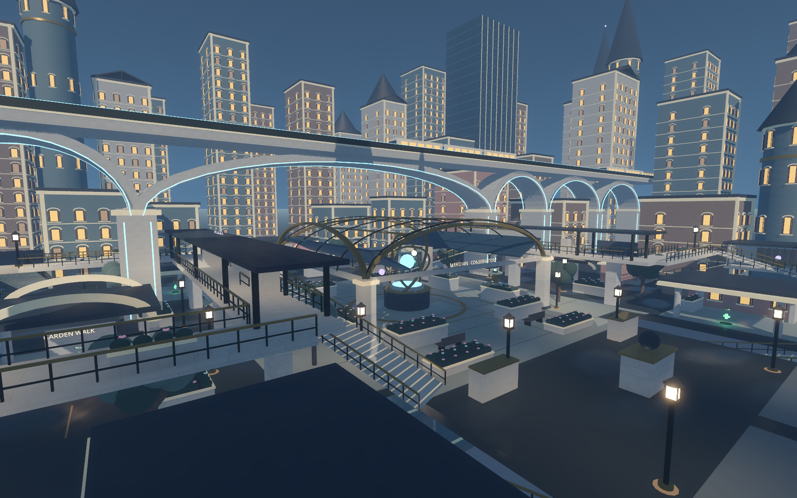
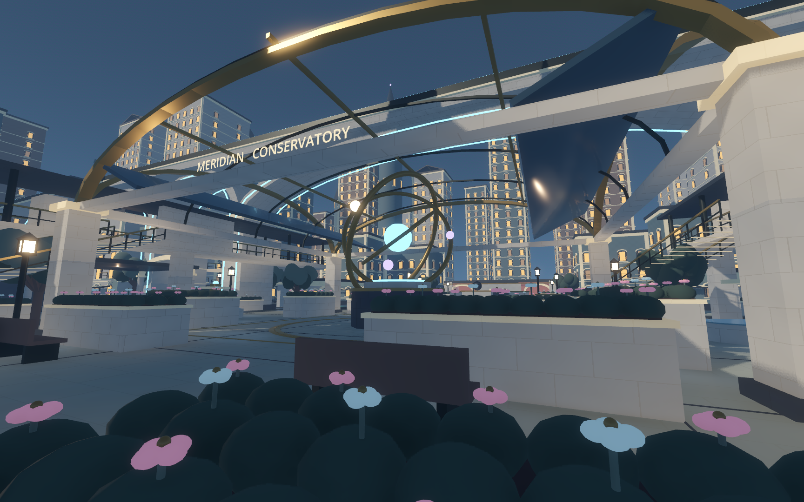
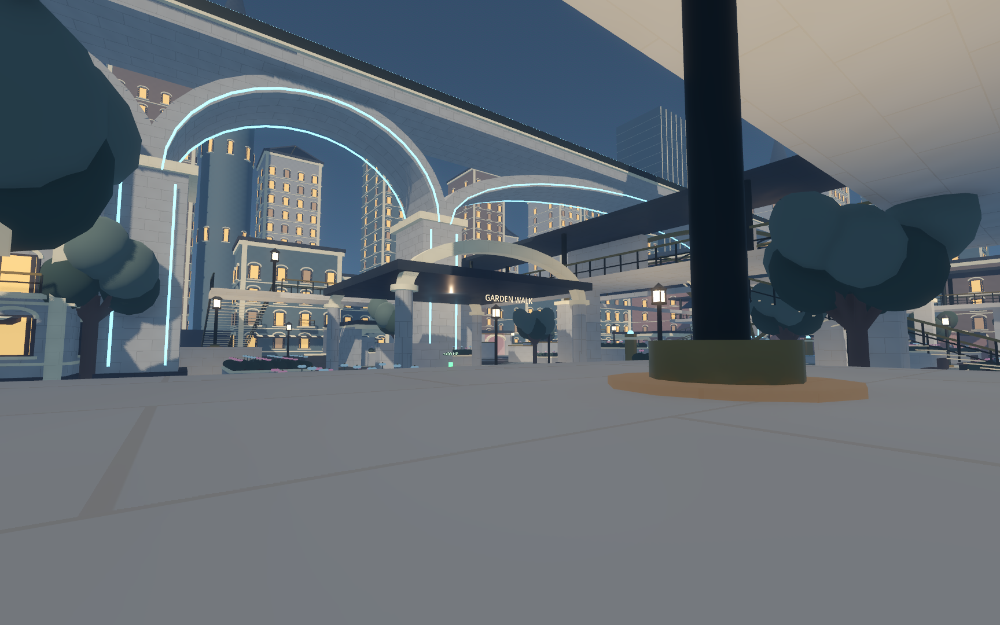
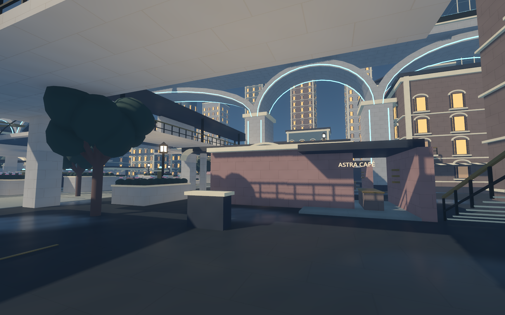
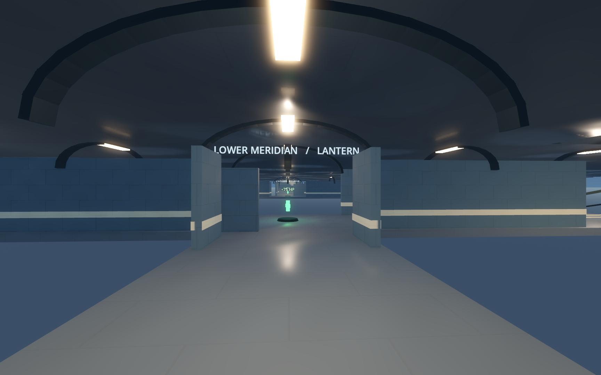
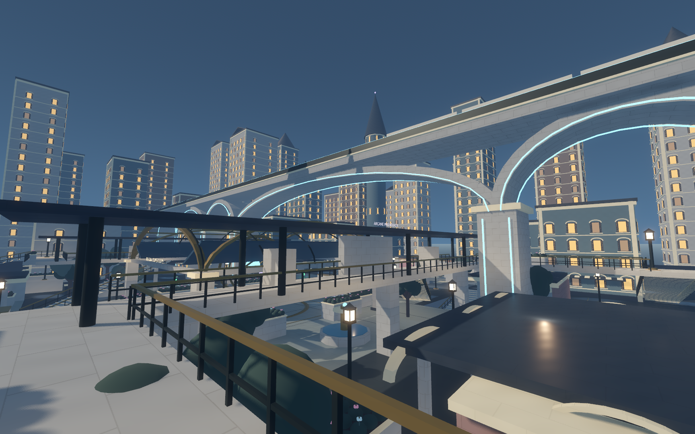
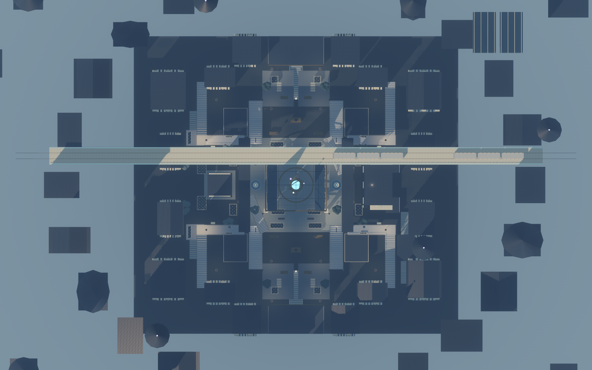
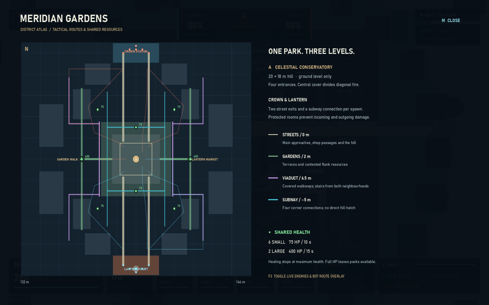
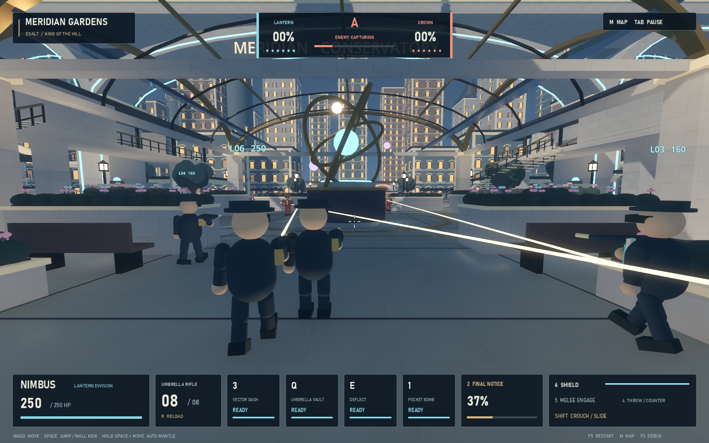

# Meridian Gardens

A playable offline 6v6 King of the Hill district for Godot 4.7.2. You play Nimbus with five Nimbus allies against six Nimbus opponents. The project launches into the city; the pause menu opens the original training arena. `Launch.ps1 -Training` starts training directly.

## Field guide

**WASD / mouse** move and look. **Space** jumps or wall kicks; hold Space while moving into a ledge to mantle. **3** dash, **Q** umbrella vault, **E** deflect, **1** bomb, **2** ultimate, **Shift** slide, **5** melee, **4** throw/counter, **6** shield. **M** opens the district atlas, **F3** adds live route/resource telemetry, **Tab / Esc** pauses, **F5** restarts the match. The pause menu includes exploration and return to training. Exploration freezes bots and the match clock and gives the player unlimited resources and invulnerability; restart restores ordinary rules.

The hill unlocks after twenty seconds. Five uncontested seconds capture it. Owning it earns one percent per second, including when empty. Any enemy on the hill stops ownership scoring; both teams together also stop capture. Abandoned partial captures decay. Only living ground-level actors inside the 20 × 18 m brass outline count. Subway occupants and elevated promenade occupants cannot capture from another floor. First to 100% wins. Respawn takes eight seconds; earned ultimate charge survives death. A fresh match starts everyone at zero ultimate.

Both protected spawn rooms have two street exits and a subway connection. Enemy actors cannot cross the team gates. Damage and throws are rejected at the shared authority boundary whenever either participant is inside a protected room, including attacks already in flight.

## Routes and resources

The playable district measures 144 × 132 m. Crown Station sits north, Lantern Court south. The central 44 × 42 m park frames the celestial conservatory and its slowly rotating orrery. Substantial central and garden cover splits diagonal fire. The western Garden Walk has terraces, a fountain pavilion and apartment arcades; the eastern Lantern Market has cafés, connected shop passages and an accessible wizard’s study. The grand railway carries scenic trains above separate, permanent combat promenades.

| Layer | Access and purpose |
| --- | --- |
| Street / 0 m | Main streets, four hill entrances, through arcades and health alcoves |
| Terrace / 2 m | Garden platforms with ordinary stairs and mantle shortcuts |
| Balcony / 4 m | Market balconies and wizard’s study, reached by stairs |
| Promenade / 6.5 m | Covered high ground with multiple stairs, opaque cover and retreat routes |
| Lower Meridian / −5 m | Underground loop with four corner stairs and spawn connections; no hatch onto the hill |

All eight health caches are shared between teams and sit outside the capture area. Full-health actors leave them available. Healing never exceeds maximum health or restores shields, ammunition, cooldowns or ultimate.

| Type | Healing | Respawn | Locations |
| --- | --- | --- | --- |
| Small × 4 | 75 HP | 10 s | Approach interiors near `(±24, 0, ±28)` |
| Small × 2 | 75 HP | 10 s | Subway recesses near `(0, −5, ±18)` |
| Large × 2 | **400 HP** | 15 s | Garden pavilion / market arcade near `(±34, 0, 0)` |

## Architecture and rendering

The original reusable kit combines ivory masonry, cornices, arched windows, slate roofs, brass, modern glass, glowing homes and restrained cyan/violet magic. Strong medical green identifies pickups. A surrounding scenic skyline suggests a much larger inhabited city. Apartment interiors are limited to tactical passages and selected rooms.

Forward+ supplies the sun, combat shadows, local lights, glow and atmospheric effects. Repeated architectural details use shared meshes/materials and MultiMeshes. Decorative details are separate from simple collision volumes; visible steps use smooth collision ramps. Static indirect lamp illumination is baked into three world-space irradiance texture layers for subway, street and promenade heights. This procedural bake is not a LightmapGI bake. The city also includes an original quiet storm-wind/transit audio bed.

The authored collision geometry generates one pedestrian NavigationMesh at startup. The match clock waits for navigation readiness. Bots make staggered tactical decisions at 5 Hz and retarget paths at no more than 2 Hz while steering each physics tick. Frontline, flank, subway and high-ground assignments lead into shared ordinary Nimbus combat. Injured bots seek available health below 40%. Parkour remains a player shortcut.

## Reproduce checks and captures

Run `tools/verify.ps1` for existing gameplay regressions plus focused city rules and integration checks. Additional long runs:

```text
godot --headless --path . --fixed-fps 60 --script res://tests/city_simulation_test.gd -- --seconds=600 --seed=76
godot --headless --path . --fixed-fps 60 --script res://tests/city_simulation_test.gd -- --seconds=600 --seed=971
godot --path . --script res://tests/capture_city.gd --resolution 1920x1080 --audio-driver Dummy --fixed-fps 60
godot --path . --script res://tests/city_performance.gd --resolution 1920x1080 --audio-driver Dummy
```

Use the installed Godot 4.7.2 executable in place of `godot` when it is not on PATH. The performance run uses real elapsed time, disables VSync and keeps twelve actors fighting with benchmark-only enlarged health pools. Production Nimbus remains at 250 HP. Capture and verification outputs live under ignored `artifacts/`.

The map-definition resource is `resources/maps/meridian_gardens.tres`; its script owns spawns, objective dimensions, health positions, district labels and navigation references. Geometry, match lifecycle, hill rules, pickups, bot tactics and HUD are separate city modules. The training scene remains independently runnable.

This build does not include multiplayer, other heroes, rideable trains or full apartment exploration. Human playtesting is still needed for competitive balance, comfort and team-fight pacing.

## Verified build — 16 October 2026

**440 automated checks pass**: 288 existing gameplay regressions, 33 city-rule checks, 70 full-city integration checks, 17 physical traversal checks and 32 scene-transition checks. Tests cover 250 HP Nimbus, a 500 HP tank and a 600 HP higher-health fixture, including full 400 HP restoration and missing-health caps. Spawn roofs also block vault entry from above. Navigation warmup grants no starting ultimate, and entering exploration while dead revives the player immediately. Paused city/training transitions and leaving before navigation finishes release the previous scene and its actors cleanly.

Actual navigation paths measure **10.12–10.16 s** for the two main approaches and **13.45–13.72 s** for surface flanks at 6 m/s. Capsule sweeps clear the authored routes. Real player physics reaches the 2 m terrace, 4.2 m study, 6.5 m promenade and −5 m subway using movement alone, with a clear shoulder camera.

| Ten-minute simulation | Seed 76 | Seed 971 |
| --- | --- | --- |
| Capture changes, Lantern / Crown | 6 / 6 | 5 / 7 |
| Seconds sampled as contested | 235 | 286 |
| Deaths / health collections | 164 / 100 | 169 / 106 |
| Completed and reset rounds | 2 | 1 |
| Longest temporary stall | 2 s | 6 s |
| Persistent ≥8 s stalls / falls / recovery teleports | 0 / 0 / 0 | 0 / 0 / 0 |

Both runs pass all fourteen simulation checks, including both teams physically reaching the covered promenade deck at approximately 6.51 m, subway use, captures, contests, health-seeking and the 5 Hz / 2 Hz decision budgets. The simulated player slot uses the same bot controller so all twelve slots can fight unattended. Exact fight outcomes can vary with asynchronous navigation startup scheduling.

The clean rendered benchmark on this PC’s **RTX 3080**, Forward+, **1920 × 1080**, measured **136.5 FPS average**, **8.98 ms p95** and **9.34 ms p99** over twenty seconds after a five-second warmup. All twelve combatants remained active, using enlarged benchmark-only health pools to sustain the fight; VSync was disabled. This is one representative shoulder-camera fight, not a guarantee for every future content addition or machine. [Raw verification records](validation/meridian) are saved with the project.

## In-engine gallery


















