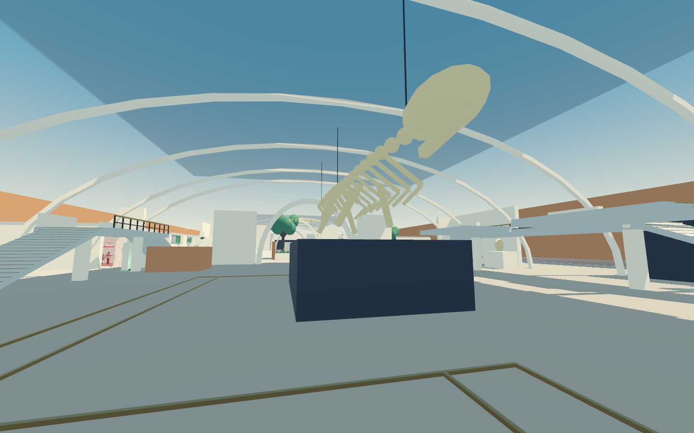

# Meridian Museum

Meridian Museum is an offline 6v6 hybrid capture/payload map. Attackers seize the Astrolabe Court in three permanent thirds, then escort an artifact transport through the Hall of Giants, Living Terrace, and Conservation Vault. The third payload checkpoint is the finish. Defenders win if the clock expires without a continuing attacker touch.

## Play

Select **Museum / Capture + Payload** from the main menu, choose **Attack**, **Defend**, or **Explore**, then select any of the eight heroes.

```powershell
.\Launch.ps1 -Museum
.\Launch.ps1 -Museum -Defend -Dynamo
.\Launch.ps1 -Museum -Explore -Wisp
```

M opens the museum atlas; B changes its floor emphasis. Tab/Escape opens the shared pause/settings/hero menu. F5 restarts the round. Hero changes apply immediately in the active spawn or queue for the next respawn. Exploration pauses the objective and bots and enables safe resource-rich traversal. The existing city and training remain separate menu choices.

## Floor plans and landmarks

[Ground floor and sunken garden](maps/museum-ground.svg) · [Elevated routes and movement shortcuts](maps/museum-elevated.svg)



[In-game ground atlas](maps/museum-atlas-ground.png) · [In-game elevated atlas](maps/museum-atlas-elevated.png)

Both vector plans are generated from the actual collision footprints, stairs, shortcuts, pickups, and spawn definitions. Gold marks the cart route and ordinary stairs, cyan marks movement shortcuts, and green marks shared healing. In-game plans also show live actors, the active objective, and the active spawn rooms.

| Fight | Route choices | Movement and cover |
| --- | --- | --- |
| **A: Astrolabe Court** | Central arcade, sculpture cloister, café approach; northern crescent and southern cloister balconies | 18 × 14 m ground capture volume; astrolabe pedestal divides the fight; 1.2 m mantle steps and alternating kick walls reach +3.6 m positions |
| **CP1: Hall of Giants** | Cart bends around the fossil island; research passage and offset education mezzanines | +4 m high ground, broad ordinary access from both ends; 4 m shared-dash gap with a safe gallery underneath; suspended skeleton and opaque exhibit bases |
| **CP2: Living Terrace** | Curved promenade, planted roof walk, lower sculpture garden with two entries and two exits | Garden at −1.5 m, roof walk at +4.5 m; 1.5 m mantle chain and 5 m dash gap; both gaps land on playable lower space if missed |
| **CP3: Conservation Vault** | Cart wraps restoration bays; packing-room and archive rotations contest a service gantry | Main floor +1.5 m, gantry +5 m; packing-crate mantles and service-wall kicks; final dock approached after a bend; defender service walls require a longer final rotation |

The payload path is 210.07 m: 70 m to CP1, another 70.07 m including the conservation rise, and 70 m to the dock. Solid walls, plinths, planters, and restoration bays supply cover. Transparent display glass and the decorative skeleton do not block bullets; the exhibit bases do. All primary perches have two ordinary approaches, and optional skill routes do not gate bot navigation.

Each area contains two 75-HP packs with a 10-second cooldown and one 400-HP pack with a 15-second cooldown. Packs are shared by both teams.

## Match rules

| Rule | Default |
| --- | --- |
| Preparation | 30 seconds after navigation is ready; attacker gates closed, defenders can deploy |
| Capture clock | 4 minutes |
| Full capture time | 30 / 24 / 20 seconds with 1 / 2 / 3+ attackers |
| Capture locks | Each completed third is permanent; living defenders in the ground volume pause capture |
| Capture decay | After 5 seconds without attackers, incomplete progress decays at the single-attacker rate to the last locked third |
| Capture completed | Cart unlocks; 3 minutes added; capture zone permanently deactivates |
| Escort | Living attackers within 5 m horizontally and 2 m vertically, with an unobstructed line to the cart |
| Cart speed | 1.5 / 1.8 / 2.0 m/s with 1 / 2 / 3+ attackers |
| Contest | A living defender in the same visible proximity volume stops forward travel and rollback |
| Rollback | After 10 unattended seconds, 0.5 m/s back to the last checkpoint; never before the start |
| CP1 / CP2 | Lock distance and add 90 seconds exactly once |
| CP3 | Immediate attacker victory |
| Overtime | Attacker touch at clock expiry starts overtime; three continuous seconds without attackers ends it; a time-awarding objective exits overtime |
| Respawn | 8 seconds; existing ultimate-retention rules apply |
| Active spawn | Team-only gates, protected combat rules, 200 HP/s healing |

Capture activates A1/D1; CP1 activates A2/D2; CP2 activates A3. Friendly living occupants of the old room move safely into the new room without a health reset. Other living actors keep their positions. Dead actors use the new room when their respawn completes. Retired rooms lose protection, healing, and gate blocking.

The cart has a solid artifact core and a rideable platform. Riders move with the cart through bends and rollback. Nearby pedestrians are displaced through checked character movement. Dynamo wall previews turn invalid on the remaining track clearance, including the possible rollback route to the latest checkpoint; the HUD explains the restriction. Completed legs and ordinary off-track positions remain available for walls.

## Implementation and tuning

`resources/maps/meridian_museum.tres` uses `MuseumMapDefinition`. Its script supplies exported defaults for capture timing, escort speed, bonuses, overtime, cart path, checkpoint vertices, spawn rooms, tactical landmarks, and pickup positions. Values can be overridden in the Inspector. Every arena duplicates the resource, keeping active spawn stages local to that match.

`MuseumObjective` owns progression. `MuseumMatch` supplies physical occupancy and reuses the city session's combat feedback, hero selection, healing, and respawns. Its public state exposes `phase`, `capture_progress`, `payload_distance`, `checkpoint_index`, `time_remaining`, `overtime`, and `winner`; signals report phase, checkpoint, spawn-stage, and round-end changes.

Bots retain shared hero tactics and ordinary navigation. Four slots pressure the active objective; additional slots rotate through high ground and flanks. Defenders stage forward when the cart is unattended and converge when a contest is urgent. No parkour planner or network mode is required.

The [route audit](validation/museum-routes.json) records navigation-distance lower bounds at 6 m/s. Initial attacker routes are roughly 9–10 seconds before acceleration and combat; defenders take roughly 11–14 seconds, with a 17.7-second final return. The intended combat return windows remain playtest targets, rather than accepted competitive balance.

## Verification

```powershell
powershell -ExecutionPolicy Bypass -File .\tools\verify.ps1
# Add -Capture for actual engine views of museum, city, and training.

# Long mixed-roster runs, followed by a bot-driven full-route drill:
godot --headless --path . --fixed-fps 60 --script res://tests/museum_simulation.gd -- --seed=76 --seconds=600
godot --headless --path . --fixed-fps 60 --script res://tests/museum_simulation.gd -- --seed=971 --seconds=600 --defend

# Refresh the authored vector plans and route measurements:
godot --headless --path . --fixed-fps 60 --script res://tools/export_museum_plans.gd
```

Use the executable resolved by `tools/find_godot.ps1` if `godot` is not on PATH. Verification keeps engine user data under `.tools/runtime`.

The museum suites cover capture/escort rules, real movement over stairs and shortcuts, navigation, physical cart clearance and rider transport, both player sides, spawn relocation, all heroes, menus, and wall-placement restrictions. Rendered views under `artifacts/museum` include all four fights, their overheads, both atlas views, and the player camera. [Validation results](validation/museum-results.json) distinguish deterministic checks, natural combat simulations, and controlled full-route drills.

The delivery audit adds real keyboard/mouse input and 192 physical edge checks, including 28 comparisons between the cart's rendered surfaces and bullet collision. It moved four packs out of exhibit/stair collisions; opened preparation gates in Explore mode; canceled old mantle trajectories during spawn transfers without resetting earned resources; preserved defenders in unchanged D2 rooms; added artifact-top rider transport and synchronized cart collision transforms; matched the artifact's visible cover to its physical collider; retained exit-facing cameras after spawn hero changes; and preserved capture-thirds feedback on a defense win. A shared movement correction excludes only the lowest 2 cm from standing-clearance probes, keeping the full standing head height while tolerating ordinary floor contact after crouching.

Each long simulation also starts a 60-second live combat scenario at each payload checkpoint, then runs the controlled full-route drill. A staged defense may legitimately stop the cart; acceptance requires actual forward progress or a contest involving both teams, rather than a guaranteed attacker win. Natural combat, staged checkpoint combat, and unopposed route completion are recorded separately.

Recorded verification: **451 focused headless checks**, **16 native-input checks**, the existing project verification suite, **32 simulation checks** across two 600-second natural combat runs plus six 60-second checkpoint combat cases, and **16 rendered views** passed. Independent sampling found no persistent eight-second route stalls; the longest sampled stalls were 3 and 3 seconds. Both controlled drills captured A and completed CP1–CP3 using ordinary bot movement, in 164 and 165 seconds respectively. These drills establish route completion under controlled pressure, not attacker win rates in balanced combat. The baseline headless import/legacy tests still print their pre-existing renderer cleanup messages; no museum test reports a script error or failed assertion.

Human playtesting remains necessary for choke pressure, long-range angles, flank commitment, final-point stalls, visual readability in combat, and movement feel. Current timing and geometry are editable first-playtest defaults.
