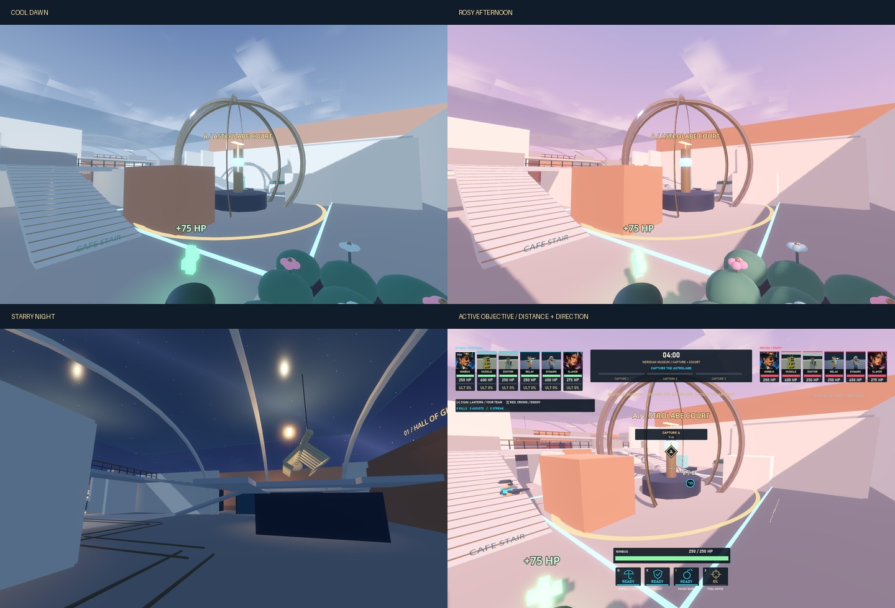

# Meridian Museum

Meridian Museum is an offline 6v6 hybrid capture/payload map, rebuilt as four connected wings around a central collection block within a 114 × 102 m footprint. Attackers seize the Astrolabe Court in three permanent thirds, then escort an artifact transport through the Hall of Giants, Living Terrace, and Conservation Vault. The third payload checkpoint is the finish. Defenders win if the clock expires without a continuing attacker touch.

## Play

Select **Museum / Capture + Payload** from the main menu, choose **Attack**, **Defend**, or **Explore**, then select any of the eight heroes.

```powershell
.\Launch.ps1 -Museum
.\Launch.ps1 -Museum -Defend -Dynamo
.\Launch.ps1 -Museum -Explore -Wisp
```

M opens the museum atlas; B changes its floor emphasis. Tab/Escape opens the shared pause/settings/hero menu. F5 restarts the round. Hero changes apply immediately in the active spawn or queue for the next respawn. Exploration pauses the objective and bots and enables safe resource-rich traversal. The existing city and training remain separate menu choices.

## Floor plans and landmarks

[Ground floor and sunken garden](maps/museum-ground.svg) · [Elevated routes and movement shortcuts](maps/museum-elevated.svg)


[In-game ground atlas](maps/museum-atlas-ground.png) · [In-game elevated atlas](maps/museum-atlas-elevated.png)

Both vector plans are generated from the actual collision footprints, stairs, shortcuts, pickups, and spawn definitions. Gold marks the cart route and ordinary stairs, cyan marks movement shortcuts, and green marks shared healing. In-game plans also show live actors, the active objective, and the active spawn rooms.

| Fight | Route choices | Movement and cover |
| --- | --- | --- |
| **A: Astrolabe Court** | Central arcade, sculpture cloister, café approach; northern crescent and southern cloister balconies | 18 × 14 m ground capture volume; astrolabe pedestal divides the fight; 1.2 m mantle steps and alternating kick walls reach +3.6 m positions |
| **CP1: Hall of Giants** | Cart bends around the fossil island; enclosed research suite and elevated education bridge | +4 m gallery and +5.8 m bridge, with ordinary stairs at both ends; 4 m shared-dash gap; bridge clears the cart and a standing artifact-top rider |
| **CP2: Living Terrace** | Promenade wraps an enclosed botanical pavilion; connected roof walk and sunken garden flank | Garden at −1.5 m, roof walk at +4.5 m; 1.5 m mantle chain and 5 m dash gap; both gaps land on playable lower space if missed |
| **CP3: Conservation Vault** | Cart wraps restoration bays; packing-room and archive rotations contest a service gantry | Main floor 0 m, gantry +3.5 m; packing-crate mantle chain and service-wall kicks; offset restoration and packing rooms divide the final fight |

The payload follows a folded 210 m route: 73 m to CP1, 77 m through the terrace to CP2, and 60 m through the vault to CP3. Building mass separates adjacent stages; there is no central shortcut between the court and vault. Solid walls, plinths, planters, and restoration bays supply cover. Transparent display glass and the decorative skeleton do not block bullets; the exhibit bases do. All primary perches have two ordinary approaches, and optional skill routes do not gate bot navigation.

Each area contains two 75-HP packs with a 10-second cooldown and one 400-HP pack with a 15-second cooldown. Packs are shared by both teams.

## Match rules

| Rule | Default |
| --- | --- |
| Preparation | 30 seconds after navigation is ready; attacker gates closed, defenders can deploy |
| Capture clock | 4 minutes |
| Full capture time | 30 / 24 / 20 seconds with 1 / 2 / 3+ attackers |
| Capture locks | Each completed third is permanent; living defenders in the ground volume pause capture |
| Capture decay | After 5 seconds without attackers, incomplete progress decays at the single-attacker rate to the last locked third |
| Capture completed | Cart unlocks; 3 minutes added; capture zone permanently deactivates |
| Escort | Living attackers within 5 m horizontally and 2 m vertically, with an unobstructed line to the cart |
| Cart speed | 1.5 / 1.8 / 2.0 m/s with 1 / 2 / 3+ attackers |
| Contest | A living defender in the same visible proximity volume stops forward travel and rollback |
| Rollback | After 10 unattended seconds, 0.5 m/s back to the last checkpoint; never before the start |
| CP1 / CP2 | Lock distance and add 90 seconds exactly once |
| CP3 | Immediate attacker victory |
| Overtime | Attacker touch at clock expiry starts overtime; three continuous seconds without attackers ends it; a time-awarding objective exits overtime |
| Respawn | 8 seconds; existing ultimate-retention rules apply |
| Active spawn | Team-operated sliding doors, friendly immunity, permitted outward firing, 200 HP/s healing |

Capture activates A1/D1; CP1 activates A2/D2; CP2 activates A3. Friendly living occupants of the old room move safely into the new room without a health reset. Other living actors keep their positions. Dead actors use the new room when their respawn completes. Retired rooms lose protection, healing, and gate blocking.

### Spawn doors and protection

Each room has two physical sliding shutters facing a staging area. A living teammate within 3 m of the doorway opens it from either side in 0.25 seconds. It stays open while a teammate is nearby, waits 0.75 seconds after they leave, then closes over 0.25 seconds. The moving collision follows the visible shutter. Enemy body collision remains at the threshold while open; enemy proximity cannot operate the door.

Inside an active friendly spawn, actors are immune to damage and hostile statuses/displacement, existing hostile effects are cleansed, and spawn healing continues. **Weapons and offensive abilities can fire outward through open doors while the actor remains protected.** Closed shutters block combat. Protection is queried from the actor's current feet position and ends immediately outside the authored boundary. Enemy breaches never grant immunity; ability motion into or through an enemy spawn is rejected. Preparation locks attacker doors and offensive actions; Explore releases them. Relocation retires old rooms as unprotected public space with open doors.

Doors have team-colored shutters, ownership/state signs, floor thresholds, and an immunity HUD indicator. The museum policy is separate from the existing Gardens and training protection policy.

[Protected firing through an open spawn door](maps/museum-spawn.png)

The cart has a solid artifact core and a rideable platform. Riders move with the cart through bends and rollback. Nearby pedestrians are displaced through checked character movement. Dynamo wall previews turn invalid on the remaining track clearance, including the possible rollback route to the latest checkpoint; the HUD explains the restriction. Completed legs and ordinary off-track positions remain available for walls.

## Implementation and tuning

`resources/maps/meridian_museum.tres` uses `MuseumMapDefinition`. Its script supplies exported defaults for capture timing, escort speed, bonuses, overtime, cart path, checkpoint vertices, spawn rooms and orientations/sizes, combat bounds, approach positions, named tactical routes, and pickup positions. Values can be overridden in the Inspector. Every arena duplicates the resource, keeping active spawn stages local to that match.

`MuseumObjective` owns progression. `MuseumMatch` supplies physical occupancy and reuses the city session's combat feedback, hero selection, healing, and respawns. Its public state exposes `phase`, `capture_progress`, `payload_distance`, `checkpoint_index`, `time_remaining`, `overtime`, and `winner`; signals report phase, checkpoint, spawn-stage, and round-end changes.

Bots retain shared hero tactics and ordinary navigation. Four slots pressure the active objective; additional slots follow named high-ground/flank routes through entry, intermediate, and exit positions. Route state resets on death/restart and changes with the objective sector; high-ground bots briefly hold a combat perch before completing the rotation. Defenders stage forward when the cart is unattended and converge when a contest is urgent. No parkour planner or network mode is required.

The [route audit](validation/museum-routes.json) records navigation-distance lower bounds at 6 m/s, checking both path endpoints. The current starting-position walks are A0 10.3 s, A1 7.6 s, A2 12.8 s, A3 9.2 s; D0 11.9 s, D1 13.9 s, D2 10.5 s to its first hold and 14.6 s to the final dock. Acceleration, doors, and the cart's changing position affect actual returns. A1's initial unlock return and D2's first hold remain faster than the original pacing targets; those are explicit balance-playtest items. No artificial screening-wall detours were added to force a timing number.

## Verification

```powershell
powershell -ExecutionPolicy Bypass -File .\tools\verify.ps1
# Add -Capture for actual engine views of museum, city, and training.

# Long mixed-roster runs, followed by a bot-driven full-route drill:
godot --headless --path . --fixed-fps 60 --script res://tests/museum_simulation.gd -- --seed=76 --seconds=600
godot --headless --path . --fixed-fps 60 --script res://tests/museum_simulation.gd -- --seed=971 --seconds=600 --defend

# Refresh the authored vector plans and route measurements:
godot --headless --path . --fixed-fps 60 --script res://tools/export_museum_plans.gd
```

Use the executable resolved by `tools/find_godot.ps1` if `godot` is not on PATH. Verification keeps engine user data under `.tools/runtime`.

The museum suites cover capture/escort rules, real movement over stairs and shortcuts, navigation, physical cart clearance and rider transport, both player sides, spawn relocation, all heroes, menus, and wall-placement restrictions. Rendered views under `artifacts/museum` include all four fights, their overheads, both atlas views, and the player camera. [Validation results](validation/museum-results.json) distinguish deterministic checks, natural combat simulations, and controlled full-route drills.

The redesign audit checks every door's ownership, timing, physical passage, protected outgoing damage, incoming weapon/projectile/splash/DoT immunity, hostile effects, threshold transitions, ability exclusion, and retirement/reset. It also sweeps the complete route with cart-plus-standing-rider clearance, verifies ordinary tactical-route segments, and checks that each authored primary perch cannot see all three approach samples. The latter is a deterministic spatial check, not proof of balanced sightlines everywhere.

The traversal suite exercises every step of the court, terrace, and packing mantle chains, both dash gaps, and wall kicks. Integration physically walks every ordinary stair in both directions and both outer lanes of the garden ramps. An initial stress run found a garden-edge gutter that could stall a bot; both ramps now fill the excavated opening. Cart cover, pickups, hero cameras, spawn transfers, queued switching, pause/reset, and both player sides retain focused regression checks.

Each seeded simulation runs 600 seconds of natural full-roster combat, three separate 60-second checkpoint fights, then a controlled bot-driven capture/escort drill. Staged combat requires real progress or contest; the controlled drill requires CP1–CP3 and the attacker victory. Natural outcomes and drill outcomes are recorded separately in [validation results](validation/museum-results.json). Rendered evidence includes all four fights, overheads, both atlas levels, objective HUD states, and closed/open spawn doors. Baseline headless import and some legacy tests still print renderer cleanup messages.

Recorded verification: **849 focused checks**, **16 native-input checks**, **32 simulation checks**, and **18 rendered views** passed, alongside the existing project verification suite. Both 600-second seeds had zero falls, zero recovery teleports, and no persistent eight-second route stalls. The controlled drills completed capture and CP1–CP3 in 166 and 165 seconds. These results establish functional routes and rules, not competitive balance.

Human playtesting remains necessary for choke pressure, long-range angles, flank commitment, final-point stalls, visual readability in combat, and movement feel. Current timing and geometry are editable first-playtest defaults.

## Objective guidance and time of day

A gold **A** diamond identifies the active capture point; after capture it becomes a **P** marker following the cart. The HUD shows the next checkpoint, horizontal distance, and above/below guidance when applicable. Off-screen arrows point toward the objective, including when it is behind the camera. The HUD marker stays visible through architecture, while the ground ring and vertical world beacon respect scene depth. Contest changes the marker to coral. Finished rounds hide guidance; restart restores the capture marker. The atlas highlights the active objective as well.

Select **Cool Dawn**, **Rosy Afternoon**, or **Starry Night** on the Museum startup page. During play, use **Pause → Museum Lighting** to change instantly. Selection persists between visits; restarts keep the current lighting. `Launch.ps1 -Museum -Lighting Dawn` (or `Afternoon` / `Night`) overrides the saved choice for that launch.

Dawn has cool blue light, low sun and pale mist. Afternoon uses brilliant rose sunlight, pink clouds and warm stone. Night combines a procedural star field, moonlight, warm exhibit lights and emissive fixtures. All presets retain ambient and fill illumination for combat readability. They share identical geometry, navigation and objective tuning. Lighting colors, intensities and fixture locations are editable in `scripts/museum/museum_lighting.gd`; the sky is procedural in `shaders/museum_sky.gdshader`.



The presentation regression suite checks preset switching without geometry changes, saved preferences, paused live updates, objective transitions, contest/finish/reset, team-specific captions, and marker projection at four window sizes. Native captures cover all four fights in all three presets, the star field, objective guidance through walls and off screen, payload/contest guidance, and the lighting menu. Run `tests/capture_museum_lighting.gd` with a graphical Godot instance to refresh the 19 views under `artifacts/museum/lighting` (also included by `verify.ps1 -Capture`). Presentation evidence is recorded separately in [museum presentation results](validation/museum-presentation.json).
